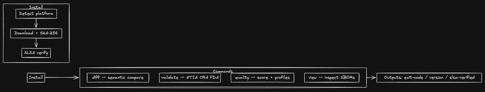

# sbom-tools GitHub Action

Install and run [sbom-tools](https://github.com/sbom-tool/sbom-tools) in your GitHub Actions workflows for semantic SBOM diff, compliance validation, quality scoring, enrichment, verification, VEX and license checking.

<p align="center">
  
</p>

The Action downloads a prebuilt sbom-tools release, checks its SHA-256 checksum and its build provenance, and runs one sbom-tools command. Any failing gate fails the step. Prebuilt binaries cover Linux (x86_64, ARM64), macOS (x86_64, ARM64) and Windows (x86_64).

> **v2 runs sbom-tools 0.4.x.** For sbom-tools 0.3.x and earlier, keep `sbom-tool/sbom-tools-action@v1`. Upgrading from v1? See [Migrating from v1](#migrating-from-v1).

## Contents

- [Quick start](#quick-start)
- [Versions](#versions)
- [Exit codes](#exit-codes)
- [Examples](#examples)
- [Inputs](#inputs)
- [Outputs](#outputs)
- [Security](#security)
- [Migrating from v1](#migrating-from-v1)
- [Development](#development)

## Quick start

Check an SBOM against the EU Cyber Resilience Act and the NTIA minimum elements, and show the findings in code scanning:

```yaml
name: SBOM compliance

on:
  pull_request:
  push:
    branches: [main]

permissions:
  contents: read

jobs:
  validate:
    runs-on: ubuntu-latest
    permissions:
      contents: read
      security-events: write # upload-sarif
    steps:
      - uses: actions/checkout@3d3c42e5aac5ba805825da76410c181273ba90b1 # v7.0.1
        with:
          persist-credentials: false

      - name: Validate the SBOM
        id: sbom
        uses: sbom-tool/sbom-tools-action@v2
        with:
          command: validate
          args: sbom.cdx.json
          standard: cra,ntia
          output-format: sarif
          output-file: sbom-compliance.sarif
          sarif-category: sbom-tools/cra+ntia/app

      - name: Upload the findings to code scanning
        # Also after a failing gate (the report exists); not after exit 3.
        if: always() && steps.sbom.outputs.output-file != ''
        uses: github/codeql-action/upload-sarif@9b3254085494b55a0f7c4c2b3d2d52cc712ce370 # v4.39.1
        with:
          sarif_file: ${{ steps.sbom.outputs.output-file }}
```

A non-compliant SBOM fails the `Validate the SBOM` step with exit code 1 and an annotation saying so. The findings still reach code scanning, because the upload step runs on `always()` and the report was written.

Set the code-scanning category with `sarif-category`, not with upload-sarif's `category` input. sbom-tools writes the category into the SARIF (`runs[].automationDetails.id`), and upload-sarif only fills in a category when the SARIF has none. Without `sarif-category`, the category is the default for the run, here `sbom-tools/cra+ntia/`.

## Versions

The `version` input picks the sbom-tools release:

| `version` | What runs |
|-----------|-----------|
| `0.4.0` (default) | Exactly sbom-tools 0.4.0. Each release of this Action sets the default to the 0.4.x release it was tested with. |
| `0.4.3`, `0.4.0-rc.1`, ... | Exactly that 0.4.x release, as given. |
| `latest` | The newest published 0.4.x release (not drafts, not pre-releases). It never moves to 0.5.0. |
| `0.3.x` and earlier | Rejected: use `sbom-tool/sbom-tools-action@v1`. |
| `0.5.0` and later | Rejected: a later major version of this Action will run those. |

sbom-tools is pre-1.0, so a minor release (0.4 to 0.5) may change exit codes, flags or output. That is why v2 stays on the 0.4 line, and why its default is an exact release rather than `latest`: a workflow that pins this Action gets the same sbom-tools every run.

Writing `version: v0.4.0` (with a `v`) is an error that tells you to drop the `v`.

### Pinning the Action

The examples here use `@v2` for readability. For the strongest supply-chain guarantee, pin the Action to a full commit SHA, and keep the version in a comment:

```yaml
- uses: sbom-tool/sbom-tools-action@<full commit SHA> # v2.0.0
```

Find the SHA of a release with `git ls-remote https://github.com/sbom-tool/sbom-tools-action refs/tags/v2.0.0`, or let Dependabot or Renovate maintain the pin.

## Exit codes

The Action runs sbom-tools and reports how it exited:

- **0** passes the step.
- **Any other code fails the step**, with sbom-tools' own exit code, and an `::error::` annotation that says what the code means for the command that ran (for `validate`, exit 1 means compliance errors; for `diff`, it means changes were found).
- The `exit-code` output is set either way. When the Action fails before sbom-tools runs (an invalid input, a failed download or verification), `exit-code` is `3`.

| Code | Meaning | From |
|------|---------|------|
| `0` | Success; every requested gate passed. A standard that does not apply to the SBOM (N/A) also exits 0, unless `require-applicable`. | all commands |
| `1` | Gate failed. `validate`: compliance errors, or a selected standard is N/A under `require-applicable`. `diff`: changes under `fail-on-change`. `quality`: score below `min-score`, or non-compliant under `--fail-on-noncompliant`. `query`: no component matched. `vex status`/`vex filter`: actionable vulnerabilities under `--actionable-only`. `verify`: verification failed. | `validate`, `diff`, `quality`, `query`, `vex`, `verify` |
| `2` | `validate`: compliance warnings under `fail-on-warning`. `diff`: new vulnerabilities under `fail-on-vuln`. `view`: vulnerabilities under `fail-on-vuln`. | `validate`, `diff`, `view` |
| `3` | Configuration error: sbom-tools rejected its arguments (an unknown flag or value, a flag the command does not take) or could not complete (an unreadable or unparsable SBOM, an invalid `as-of` or `cra-sidecar`). Also the Action's own failures before sbom-tools runs. Never a gate verdict. | all commands, and the Action |
| `4` | Introduced vulnerabilities lack VEX statements (`fail-on-vex-gap`). | `diff` |
| `5` | License policy violations. | `license-check` |
| `6` | An introduced vulnerability is in CISA's Known Exploited Vulnerabilities catalog (`--fail-on-kev` in `args`). | `diff` |
| `7` | An ML model's performance metric regressed (`--fail-on-ml-regression` in `args`). | `diff` |
| other | sbom-tools crashed or was killed. | |

The gate codes come from sbom-tools' own flags; the Action adds no fail switches of its own. Each command's `--help` has its `EXIT CODES` section.

### Soft gates

To report a gate without failing the job, let the step continue on error and read `exit-code`:

```yaml
- name: CRA readiness (reported, not enforced yet)
  id: cra
  continue-on-error: true
  uses: sbom-tool/sbom-tools-action@v2
  with:
    command: validate
    args: sbom.cdx.json
    standard: cra

- name: Note the gap
  if: steps.cra.outputs.exit-code == '1'
  run: echo "::warning::The SBOM is not CRA-compliant yet"

# continue-on-error swallows every failure, configuration errors included,
# so fail on anything but the code you meant to soften.
- name: Fail on anything else
  if: steps.cra.outcome == 'failure' && steps.cra.outputs.exit-code != '1'
  env:
    EXIT_CODE: ${{ steps.cra.outputs.exit-code }}
  run: |
    echo "::error::sbom-tools exited ${EXIT_CODE}"
    exit 1
```

With `continue-on-error`, the step's `outcome` is `failure` and its `conclusion` is `success`, so the job carries on.

## Examples

### Diff gate on pull requests

Fail a pull request that introduces vulnerabilities, compared with the SBOM on the base branch:

```yaml
on:
  pull_request:
    paths: ['sbom.cdx.json']

jobs:
  sbom-diff:
    runs-on: ubuntu-latest
    steps:
      - uses: actions/checkout@3d3c42e5aac5ba805825da76410c181273ba90b1 # v7.0.1
        with:
          fetch-depth: 0
          persist-credentials: false

      - name: Get the base branch SBOM
        env:
          BASE_REF: ${{ github.base_ref }}
        run: git show "origin/${BASE_REF}:sbom.cdx.json" > base.cdx.json

      - name: Diff the SBOMs
        uses: sbom-tool/sbom-tools-action@v2
        with:
          command: diff
          args: base.cdx.json sbom.cdx.json
          fail-on-vuln: true
          enrich-vulns: true
```

Add `fail-on-change: true` to fail on any change (exit 1), or put `--kev --fail-on-kev` in `args` to fail only on actively exploited vulnerabilities (exit 6).

### Quality score threshold

```yaml
- uses: sbom-tool/sbom-tools-action@v2
  with:
    command: quality
    args: sbom.cdx.json
    profile: security
    min-score: '80'
```

### Several SBOMs in one workflow

Code scanning keeps one set of alerts per category, and upload-sarif fails a job that uploads two files with the same category. Give each SBOM its own `sarif-category`:

```yaml
strategy:
  matrix:
    service: [api, web]
steps:
  - uses: actions/checkout@3d3c42e5aac5ba805825da76410c181273ba90b1 # v7.0.1
    with:
      persist-credentials: false
  - id: sbom
    uses: sbom-tool/sbom-tools-action@v2
    with:
      command: validate
      args: services/${{ matrix.service }}/sbom.cdx.json
      standard: cra
      output-format: sarif
      output-file: ${{ matrix.service }}.sarif
      sarif-category: sbom-tools/cra/${{ matrix.service }}
  - if: always() && steps.sbom.outputs.output-file != ''
    uses: github/codeql-action/upload-sarif@9b3254085494b55a0f7c4c2b3d2d52cc712ce370 # v4.39.1
    with:
      sarif_file: ${{ steps.sbom.outputs.output-file }}
```

### CRA with a sidecar and a pinned clock

```yaml
- uses: sbom-tool/sbom-tools-action@v2
  with:
    command: validate
    args: sbom.cdx.json
    standard: cra-phase1
    cra-sidecar: sbom.cra.yaml
    cra-product-class: important-class-1
    as-of: '2026-12-01'
    fail-on-warning: true
```

`as-of` makes deadline-sensitive checks (CRA Art. 14 readiness, SBOM age, certificate expiry) reproducible from run to run.

### VEX

```yaml
# Fail when a vulnerability the diff introduces has no VEX statement (exit 4).
- uses: sbom-tool/sbom-tools-action@v2
  with:
    command: diff
    args: base.cdx.json sbom.cdx.json --vex vex.openvex.json
    fail-on-vex-gap: true

# Fail while actionable vulnerabilities remain (exit 1).
- uses: sbom-tool/sbom-tools-action@v2
  with:
    command: vex
    args: status sbom.cdx.json --vex vex.openvex.json --actionable-only
```

For `vex` and `verify`, the subcommand comes first in `args`.

### Licenses and hashes

```yaml
- uses: sbom-tool/sbom-tools-action@v2
  with:
    command: license-check
    args: sbom.cdx.json --strict

- uses: sbom-tool/sbom-tools-action@v2
  with:
    command: verify
    args: hash sbom.cdx.json --hash-file sbom.cdx.json.sha256
```

### Running a binary you built

`binary-path` runs an existing binary instead of downloading a release, for example one built from source:

```yaml
- name: Build sbom-tools
  run: cargo install sbom-tools --locked --version 0.4.0 --root "$RUNNER_TEMP/sbom-tools"

- uses: sbom-tool/sbom-tools-action@v2
  with:
    binary-path: ${{ runner.temp }}/sbom-tools/bin/sbom-tools
    command: validate
    args: sbom.cdx.json
```

With `binary-path`, the Action skips the download and the checksum and provenance checks, and ignores `version` and `verify-provenance`. The `version` output is what the binary's `--version` reports; the Action warns when that is not a 0.4.x version.

## Inputs

Each input that is set adds one sbom-tools flag; flags with a value are passed as `--flag=value`. The Action does not check which command takes which flag: sbom-tools does, and a flag the command does not take makes it exit 3.

| Input | Default | Passed as | Taken by |
|-------|---------|-----------|----------|
| `command` | *required* | the command | One of `diff`, `validate`, `quality`, `view`, `query`, `enrich`, `verify`, `license-check`, `vex` |
| `args` | `''` | the arguments after the command; see [How args is split](#how-args-is-split) | all |
| `version` | `0.4.0` | the release to install; see [Versions](#versions) | |
| `fail-on-vuln` | `false` | `--fail-on-vuln` (exit 2) | `diff`, `view` |
| `fail-on-change` | `false` | `--fail-on-change` (exit 1) | `diff` |
| `fail-on-vex-gap` | `false` | `--fail-on-vex-gap` (exit 4) | `diff` |
| `fail-on-warning` | `false` | `--fail-on-warning` (exit 2) | `validate` |
| `require-applicable` | `false` | `--require-applicable` (exit 1 for an N/A standard) | `validate` |
| `enrich-vulns` | `false` | `--enrich-vulns` (OSV vulnerability data) | `diff`, `view`, `quality`, `query`, `enrich`, `vex apply`/`status`/`filter` |
| `output-format` | `''` | `--output=<format>`: `summary`, `json`, `sarif`, `oscal-json`, `markdown`, `html`, `table`, `csv`, `ndjson`, `side-by-side`, `sbomqs-json` | `diff`, `view`, `validate`, `quality`, `query`, `vex apply`/`status`/`filter`, `license-check` (`table`, `json`), `verify` except `hash` and `receipt-generate` (`table`, `json`) |
| `output-file` | `''` | `--output-file=<path>` | `diff`, `view`, `validate`, `quality`, `query`, `enrich`, `vex` |
| `min-score` | `''` | `--min-score=<0-100>` (exit 1 below it) | `quality` |
| `standard` | `''` | `--standard=<list>`, comma-separated; see [Standards](#standards) | `validate` |
| `profile` | `''` | `--profile=<name>`; see [Quality profiles](#quality-profiles) | `quality` |
| `sarif-category` | `''` | `--sarif-category=<category>`: the code-scanning category (`automationDetails.id`) | `diff`, `view`, `validate`, `quality` |
| `sarif-base` | `''` | `--sarif-base=<dir>`: the directory SARIF file paths are relative to; sbom-tools defaults to the git repository the SBOM is in | `diff`, `view`, `validate`, `quality` |
| `sarif-include-passes` | `false` | `--sarif-include-passes`: also report passed checks, as results of kind `pass` | `validate` |
| `sarif-max-results` | `''` | `--sarif-max-results=<n>`: sbom-tools keeps 25000 results by default, the most code scanning accepts; `0` keeps all | `diff`, `view`, `validate`, `quality` |
| `as-of` | `''` | `--as-of=<time>`: RFC 3339 or `YYYY-MM-DD`; deadline checks use it instead of the clock | `validate`, `quality` |
| `cra-sidecar` | `''` | `--cra-sidecar=<path>`: CRA metadata the SBOM does not carry (JSON or YAML) | `validate`, `quality`, `view` |
| `cra-product-class` | `''` | `--cra-product-class=<class>`: `default`, `important-class-1`, `important-class-2`, `critical` | `validate`, `quality`, `view` |
| `working-directory` | `.` | the directory sbom-tools runs in, relative to the workspace | |
| `verify-provenance` | `require` | `require`, `warn` or `off`; see [Binary verification](#binary-verification) | |
| `binary-path` | `''` | an existing sbom-tools binary to run instead of a release; relative paths are from the workspace root | |

Booleans must be exactly `true` or `false`; anything else, including an empty value, is an error rather than `false`. Leading and trailing whitespace is trimmed from every input except `args`.

### Standards

`standard` is passed through as given, aliases included, and sbom-tools validates it; an unknown standard exits 3. Separate several with commas: `standard: cra,ntia,eo14028`.

| Standard | What it checks | Aliases |
|----------|----------------|---------|
| `ntia` | NTIA Minimum Elements for software transparency (the default) | |
| `fda` | FDA premarket submission requirements for medical devices | |
| `cra` | EU Cyber Resilience Act, Phase 2: full application from 11 Dec 2027 | `cra-phase2` |
| `cra-phase1` | EU Cyber Resilience Act, Phase 1: the Art. 14 reporting obligations, from 11 Sep 2026 | `cra-2026` |
| `ssdf` | NIST SP 800-218 Secure Software Development Framework | `nist-ssdf`, `nist_ssdf` |
| `eo14028` | Executive Order 14028, Section 4: software supply chain security | `eo-14028`, `eo_14028` |
| `cnsa2` | NSA CNSA 2.0, the Commercial National Security Algorithm Suite 2.0 | `cnsa-2`, `cnsa_2`, `cnsa2.0` |
| `pqc` | NIST post-quantum readiness (IR 8547, FIPS 203/204/205) | `nist-pqc`, `nist_pqc` |
| `bsi` | BSI TR-03183-2 v2.1.0, the German CRA-aligned SBOM guideline | `tr-03183`, `tr03183`, `bsi-tr-03183-2` |
| `oss-steward` | CRA Article 24, the open-source software steward profile | `cra-oss-steward`, `cra-oss`, `cra-art24`, `art24` |
| `eucc` | EUCC Substantial assurance level (Reg. (EU) 2024/482), reference only | `eucc-substantial`, `common-criteria` |
| `ai-act` | EU AI Act (Reg. (EU) 2024/1689) Annex IV documentation readiness | `ai_act`, `aiact`, `eu-ai-act` |
| `bsi-ai` | BSI/G7 "SBOM for AI: Minimum Elements" readiness | `bsi_ai`, `bsiai`, `sbom-for-ai`, `ai-bom` |
| `cisa-2026` | CISA 2026 Minimum Elements for an SBOM (v2.1), successor to the NTIA 2021 elements | `cisa`, `cisa2026`, `minimum-elements-2026` |
| `pci-dss` | PCI DSS v4.0.1 Requirement 6.3.2 software inventory | `pci`, `pci-dss-6-3-2`, `pci-dss-4` |
| `fsct` | CISA Framing Software Component Transparency, 3rd edition (2024) | `fsct-3`, `component-transparency` |

A standard that does not apply to the SBOM (`ai-act` or `bsi-ai` on an SBOM without ML components, say) is reported as N/A and exits 0; with `require-applicable: true` it exits 1.

### Quality profiles

`profile` is passed through as given, aliases included, and sbom-tools validates it.

| Profile | Emphasis | Aliases |
|---------|----------|---------|
| `minimal` | Basic identification | |
| `standard` | Recommended for most uses (the default) | |
| `security` | Vulnerability information and supply chain | |
| `license-compliance` | License compliance | `license` |
| `cra` | EU Cyber Resilience Act: supply-chain transparency and security disclosure | `cyber-resilience` |
| `bsi` | BSI TR-03183-2 v2.1.0: stricter than `cra` on formats and hashes (SHA-512) | `tr-03183`, `tr03183`, `bsi-tr-03183-2` |
| `comprehensive` | Every aspect weighted equally | `full` |
| `cbom` | Cryptographic BOM: algorithm strength, post-quantum readiness, key and certificate lifecycle | `cryptographic` |
| `ai-readiness` | Model-card completeness for machine-learning components | `ai_readiness` |

### How args is split

`args` is split on whitespace (spaces, tabs and line breaks), and each word becomes one argument exactly as written. There is no quoting, escaping, variable or glob expansion: a path cannot contain a space, and `*.json` reaches sbom-tools as the text `*.json`. List files one by one, or use a YAML block for a long list:

```yaml
command: query
args: >-
  log4j
  fleet/api.cdx.json
  fleet/web.cdx.json
```

`args` can hold SBOM paths, the subcommand of `vex` or `verify` (first), and any other sbom-tools flag, such as `--kev`, `--fail-on-kev`, `--vex vex.json` or `--strict`. The Action runs

```
sbom-tools <command> <args...> <flags from the other inputs...>
```

and when `args` contains a literal `--`, the flags from the inputs go in front of it. The characters `;` `|` `&` `$` `` ` `` `(` `)` `{` `}` `!` `#` `\` `'` `"` are rejected, since nothing interprets them; `<` and `>` are allowed for version ranges (`--version <2.17.0`).

### Paths

`working-directory` is relative to the workspace; `output-file`, `cra-sidecar` and `sarif-base` are relative to `working-directory`. These four must be relative paths without a `..` component, and must stay inside the workspace once symbolic links are followed. Paths in `args` are not restricted, so an SBOM can come from `$RUNNER_TEMP`. `binary-path` may be absolute.

## Outputs

| Output | Description |
|--------|-------------|
| `exit-code` | sbom-tools' exit code (see [Exit codes](#exit-codes)), set even when the step fails; `3` when the Action fails before sbom-tools runs |
| `version` | The sbom-tools version that ran |
| `slsa-verified` | `true` when the build provenance of the downloaded binary was verified, else `false` |
| `output-file` | The absolute path of the report written to `output-file`. Set after exit 0 and after the gate codes (1, 2, 4 to 7), which always come with a report; empty after exit 3, a crash, or when `output-file` is not set |

## Security

### Binary verification

The Action checks the release archive it downloads before extracting it:

1. **SHA-256 checksum, always.** The archive must match its entry in the release's `checksums.sha256`, looked up by its exact file name.
2. **Build provenance, required by default.** `gh attestation verify` checks the archive's [artifact attestation](https://docs.github.com/actions/security-for-github-actions/using-artifact-attestations): Sigstore-signed SLSA build provenance that must name the sbom-tools release workflow (`.github/workflows/publish-crates.yml` in `sbom-tool/sbom-tools`), the release tag (`refs/tags/v<version>`), and a GitHub-hosted runner. An archive rebuilt elsewhere fails this check even with a matching checksum.

| `verify-provenance` | When provenance cannot be verified |
|---------------------|------------------------------------|
| `require` (default) | The step fails and nothing is installed. |
| `warn` | A warning; the archive is installed on its checksum alone. |
| `off` | Provenance is not checked; the checksum still is. |

The check needs the GitHub CLI (`gh`), which GitHub-hosted runners include, and uses the job's `github.token`. On a self-hosted runner without `gh`, install it or set `verify-provenance: warn`.

### Inputs and the shell

- **No expression injection.** No input is interpolated with `${{ }}` into a script: each reaches the Action's scripts through an environment variable.
- **No shell evaluation.** The command line is built as a bash array and run directly, never through `eval`. A flag's value is passed as `--flag=value`, so it cannot become another flag.
- **Strict checks.** `command` must be one of nine commands, booleans must be `true` or `false`, `min-score` must be a number, and `version` must follow the version rule. Path inputs must stay inside the workspace (see [Paths](#paths)). Values must be single lines.
- **Archive safety.** Archives are extracted into an isolated directory, and a binary that is a symbolic link is rejected.
- **Workflow commands.** sbom-tools prints text taken from the SBOM, so the Action stops workflow-command processing (`::stop-commands::`) while sbom-tools runs: an SBOM cannot forge annotations or other workflow commands in your log.

## Migrating from v1

v2 is for sbom-tools 0.4.x, which changed exit codes and output formats. What changes for your workflows:

1. **Failing gates fail the step.** v1 printed an annotation for exit codes 1, 2 and 4 and then passed the step, so `fail-on-vuln`, `fail-on-vex-gap` and a non-compliant `validate` never failed a job. In v2 every non-zero exit fails the step. For the v1 behaviour, use `continue-on-error: true` and read `exit-code` ([Soft gates](#soft-gates)).
2. **Exit 3 is a configuration error.** sbom-tools 0.4.0 exits 3 for usage and operational errors (it used to exit 2), and the Action reports it as such. Exit 2 now always means a gate: vulnerabilities, or compliance warnings under `fail-on-warning`.
3. **Annotations say what the exit means for the command.** v1 reported exit 1 as "SBOM changes detected" for every command, including `validate`, where it means compliance errors.
4. **The default version is pinned.** v1 defaulted to `latest`, the newest release overall. v2 defaults to `0.4.0`; `latest` means the newest 0.4.x; a version outside 0.4.x is an error. If you set `version: 0.3.x`, stay on v1 or move to 0.4.x.
5. **All standards and profiles.** `standard` and `profile` are passed through, so all 16 standards, all 9 profiles and their aliases work, and sbom-tools validates them (an unknown one exits 3). v1 accepted five standards and six profiles.
6. **`args` takes flags and subcommands.** v1 put `--` in front of `args`, so it could only hold file paths, and `vex` and `verify`, which need a subcommand, could not run at all. In v2, `args` comes right after the command, may hold any flag, and is split on every kind of whitespace (v1 read only its first line). `<` and `>` are allowed.
7. **`fail-on-vex-gap` is for `diff`.** v1 documented it for `vex` too, where sbom-tools never accepted it. For `vex status` and `vex filter`, put `--actionable-only` in `args`.
8. **`output-format` is passed as `--output`.** That is the long name of every command's format flag, so `license-check` now takes `output-format` too.
9. **`verify-slsa` is removed.** It was deprecated in v1, and the v1.3.0 default `verify-provenance: require` already overrode it. Use `verify-provenance`.
10. **Provenance verification works.** v1 passed the release's cosign signature bundle to `gh attestation verify --bundle`, which can never verify it, and fell back to SLSA provenance that covers the crate, not the binary archives. So with v1.3.0's default `require`, installs failed. v2 verifies the archive's artifact attestation, pinned to the release workflow and tag; `slsa-verifier` is no longer downloaded.
11. **Path checks.** A path may now contain `..` inside a name (`a..b.json`); a `..` path component is still rejected, and so is a path that leaves the workspace through a symbolic link.
12. **New inputs:** `fail-on-warning`, `require-applicable`, `sarif-category`, `sarif-base`, `sarif-include-passes`, `sarif-max-results`, `as-of`, `cra-sidecar`, `cra-product-class`, `binary-path`. **New output:** `output-file`.

sbom-tools 0.4.0 itself also changes its JSON output (a versioned envelope for `validate -o json`) and its SARIF (locations, fingerprints, one rule per check; the first upload re-keys existing alerts). See the [sbom-tools release notes](https://github.com/sbom-tool/sbom-tools/releases).

## Development

The Action is two scripts that `action.yml` runs in order: `scripts/setup.sh` validates the inputs and installs sbom-tools, and `scripts/run.sh` runs it and reports the result. `scripts/lib.sh` holds the shared functions. They run under bash 3.2 (macOS), bash 5 (Linux) and Git Bash (Windows).

The test harness runs both scripts the way `action.yml` does, with stand-ins for sbom-tools, `gh` and `curl`:

```sh
bash tests/run-tests.sh                                   # everything offline
bash tests/run-tests.sh --cli target/release/sbom-tools   # plus a real sbom-tools
bash tests/run-tests.sh --network                         # plus GitHub: 'latest', a real install
bash tests/run-tests.sh --release                         # plus the sbom-tools v0.4.0 release
bash tests/run-tests.sh argv                              # only the tests matching 'argv'
```

`--cli` runs the integration tests against an sbom-tools binary through the `binary-path` override. CI (`.github/workflows/test.yml`) runs the harness on Linux, macOS (also under `/bin/bash`) and Windows, the network tests, and the Action itself through `uses: ./`.

## License

MIT
